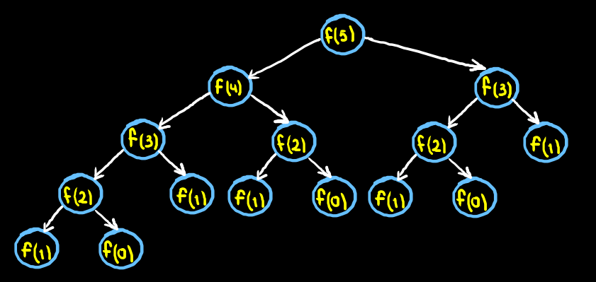

# Módulo 5. Tipos de datos, variables, expresiones y flujo de control
## Semana 5

### Sesión 1. Ayudantía de Teoria
#### Tema: Expresiones con tipos de datos primitivos en Java
- Definición de expresión en Java.
- Clasificación de expresiones por su tipo de dato.
- Escritura de expresiones algebraicas: precedencia de los operadores y uso de paréntesis. Se sugiere a los estudiantes revisar el Cuadro 3.4 Operadores de Java, en Introducción a las Ciencias de la Computación con Java, de Elisa V. y Canek P., p. 92., como referencia para la precedencia de los 46 operadores en caso de consulta. Se exponen los ejemplos de la sección.
- Ejemplo con operadores lógicos (dinero, tienda1 y tienda2 son variables booleanas, se da una historia para contextualizar):
```java
dinero == true && tienda1 == true && tienda2 == true
```
y su diferencia con:
```java
dinero == true && ( tienda1 == true && tienda2 == true )
```
- Diferencia entre los operadores lógicos && y || con & y |.
- Operadores con el mismo nivel de precedencia se evalúan de izquierda a derecha, salvo los operadores de asignación.
- Ejemplos de evaluación de derecha a izquierda con operadores de asignación (=, +=, -=).  


### Sesión 2. Ayudantía de Teoria
#### Tema: Expresiones con error de incompatibilidad de tipos
- Ejemplos básicos de expresiones mal formadas que presentan error de incompatibilidad de tipos:  
- Ejemplo 1:  
```java
int a = 4, b = 2;
String saludo = "Hola";

b = saludo + a;
```
- Ejemplo 2:  
```java
int a = 4;
if(a = 4)
    System.out.println("a es igual a 4");
```
- Ejemplo 3:  
```java
double a = 3;
int b = 1;
b = a;
```

#### Tema: Casting de tipos primitivos
- Casting de ensanchamiento (widening casting). Definición y ejemplos.
```java
int distancia = 100;
double velocidad, tiempo = 6.0;

velocidad = distancia / tiempo;
```
- Casting de estrechamiento (narrowing casting). Definición y ejemplos.
```java
double masa = 500, volumen = 400000;
float densidad;

densidad = (float)(masa / volumen);
```

## Semana 7

### Sesión 2. Ayudantía de Teoria
#### Tema: Diferencia entre sentencias, expresiones y literales en Java
- Definición y ejemplos de sentencias, expresiones y literales.
- **Sentencia**: Unidad mínima funcional de código. Suelen terminar en punto y coma (aunque no siempre es el caso).
- **Expresión**: Combinación de literales, variables, operadores y/o llamadas a métodos que devuelve un valor.
- **Literal**: Representación explícita de un valor en el código.
#### Tema: Uso de prefijos y sufijos en literales
- Literales de tipo numérico entero. En Java estas literales se asumen de tipo *int*. Para indicar una literal entera de tipo *long* se usa el sufijo *l* (ele).
- Ejemplo:
```java
     System.out.println(1000000000000);
```
- El código anterior marcará error al compilar (error: integer number too large). Para solucionar esto se agrega el sufijo *l*:
```java
     System.out.println(1000000000000l);
```
- Ejemplo:
```java
     System.out.println(1000000*1000000);
```
- El código anterior imprimirá **-727379968**, debido a un error de desbordamiento. Para solucionar esto se agrega el sufijo *l*:
```java
     System.out.println(1000000l*1000000l);
```
- Con esto ya se obtiene el resultado deseado: **1000000000000**.
- También pueden agregarse prefijos a las literales enteras para usar binario, octal o hexadecimal en su representación:

|Base|Prefijo|Ejemplo|Valor en decimal|
|--------|--------|--------|--------|
|    Binario    |    0b o 0B    | 0b111 | 7 |
|    Octal    |    0    | 0127 | 87 |
|    Hexadecimal    |    0x o 0X    | 0xaf1 | 2801 |

- Literales de tipo numérico de punto flotante. En Java estas literales se asumen de tipo *double*. Para indicar una literal entera de tipo *float* se usa el sufijo *f*. Adicionalmente puede agregarse el sufijo *d* para indicar explícitamente el tipo double (aunque esto no es necesario).
-  Ejemplos:
```java
     float f1 = 3.14f;
     double d1 = 20d;
```
- También puede usarse notación científica:
```java
     float f2 = 1e-6f;
     double d2 = 1e6;
```
- Literales de tipo *char* (caracter). En Java existen tres formas de representar estas literales:
- **Forma 1**: Con el caracter entre comillas simples.
- Ejemplo:
```java
     char c1 = 'a';
```
- También pueden emplearse secuencias de escape. Por ejemplo, para un salto de línea:
```java
     char c2 = '\n';
```
- **Forma 2**: Con un entero (octal, decimal o hexadecimal) en el intervalo 0 a 65535 (entero sin signo de 16 bits = 2 bytes).
-  Ejemplo (caracter 'A'):
```java
     char c3 = 65;
```
- **Forma 3**: Con el código *Unicode* asociado al caracter en el formato **\uxxxx**, donde **xxxx** son cuatro dígitos hexadecimales.
- Ejemplo (caracter de derechos reservados '©'):
```java
     char c4 = '\u00a9';
```
## Semana 8

### Sesión 2. Ayudantía de Teoria
#### Tema: Literales en Java (continuación)
[Dispositivas de la sesión](modulo5/diapositivasOctubre04.pdf)
- Literales de tipo *String*. Se especifican entre comillas dobles. Pueden incluir secuencias de escape y caracteres indicados con su código *Unicode* en *UTF-16* de 16 o 32 bits.
- Secuencias de escape comunes:

|Nombre|Representación|ASCII|
|--------|--------|--------|
|    Salto de línea    |    \n    | 10 |
|    Tabulación    |    \t    | 9 |
|    Comilla simple    |    \\'    | 39 |
|    Comillas dobles    |    \\"    | 34 |
|    Diagonal invertida    |    \\\    | 92 |
|    Caracter nulo    |    \0    | 0 |
- **Ejemplo 1**: Uso de secuencias de escape.
```java
public class Literales{

    public static void main(String[] args){
    
     String cadenaConSecuenciasDeEscape="\tTexto tabulado.\nComilla simple: \' \nComillas dobles: \" \nDiagonal invertida: \\ \nCaracter nulo: \0";
    
     System.out.println(cadenaConSecuenciasDeEscape);
     
    }

}
```
- **Ejemplo 2**: Impresión de emojis. En *UTF-16* (codificación empleada en Java) los emojis emplean códigos *Unicode* de dos bloques de 16 bits. Pueden expresarse con la sintaxis “\uxxxx\uxxxx”, donde cada *x* es un dígito hexadecimal.
```java
public class Literales{

    public static void main(String[] args){
    
     System.out.println("\uD83D\uDE00");     
     System.out.println("\uD83D\uDE01");
     System.out.println("\uD83D\uDE02");
     System.out.println("\uD83D\uDE03");
     System.out.println("\uD83D\uDE04");
     System.out.println("\uD83D\uDE05");
     System.out.println("\uD83D\uDE06");
     System.out.println("\uD83D\uDE07");
     System.out.println("\uD83D\uDE08");
     System.out.println("\uD83D\uDE09");
     
    }

}
```
- Literales booleanas. Sólo pueden tomar los valores *true* o *false* (verdadero o falso).
- **Ejemplo 1**:
```java
public class Literales{

    public static void main(String[] args){
    
     boolean b1 = true;
     boolean b2 = false;
     
     System.out.println(b1);
     System.out.println(b2);
     System.out.println(true);
          
    }

}
```
- Literal nula. Un objeto en Java puede inicializarse en *null*.
```java
public class Literales{

    int longitud;

    public static void main(String[] args){
    
     Literales l2 = null;
           
    }

}
```
- *null* es una literal que indica que la variable apunta a ningún objeto. Tratar de acceder a los atributos o métodos de un objeto nulo generará una excepción de puntero nulo (*NullPointerException*).
- **Ejemplo 1**:
```java
public class Literales{

    int longitud;

    public static void main(String[] args){
    
     Literales l2 = null;
     
     System.out.println(l2.longitud);
           
    }

}
```
- Al intentar compilar el código anterior se producirá un error "java.lang.NullPointerException".
#### Tema: Errores de incompatibilidad de tipos al invocar métodos
- Los errores de incompatibilidad de tipos también pueden producirse en expresiones que incluyen llamadas a métodos.
- **Ejemplo 1**: En la clase *RegistroMedico*, trabajada en sesiones anteriores, se tiene un método *getEstatura()* de tipo *double*:
```java
    public double getEstatura(){
        return estatura;
    }
```
- Si en la clase *PruebaRegistroMedico* se intenta hacer:
```java
public class PruebaRegistroMedico{

    public static void main(String[] args){
        
        RegistroMedico rm5 = new RegistroMedico("Laura","Altamira Quintanar",24,72.8,1.65);
        
        rm5.imprimeDetalles();
                
        int estaturaLaura = rm5.getEstatura();
        
    }

}
```
- Se producirá un error "incompatible types: possible lossy conversion from double to int". Esto se soluciona empleando una variable *double*:
```java
public class PruebaRegistroMedico{

    public static void main(String[] args){
        
        RegistroMedico rm5 = new RegistroMedico("Laura","Altamira Quintanar",24,72.8,1.65);
        
        rm5.imprimeDetalles();
                
        double estaturaLaura = rm5.getEstatura();
        System.out.println(estaturaLaura);
        
    }

}
```
- **Ejemplo 2**: En esta misma clase (*RegistroMedico*), obsérvese que se tiene un método getNombre() de tipo String y un método imprimeNombre() de tipo void.
```java
    public String getNombre(){
        return nombre;
    }
    
    public void imprimeNombre(){
        System.out.println(nombre);
    }
```
- Si en la clase *PruebaRegistroMedico* se hace:
```java
public class PruebaRegistroMedico{

    public static void main(String[] args){
        
        RegistroMedico rm5 = new RegistroMedico("Laura","Altamira Quintanar",24,72.8,1.65);
        
        rm5.imprimeDetalles();
                
        String nombreLaura = rm5.imprimeNombre();
        
    }

}
```
- Al intentar compilar se producirá un error "incompatible types: void cannot be converted to String". Basta con usar el método correcto para solucionar este error:
```java
public class PruebaRegistroMedico{

    public static void main(String[] args){
        
        RegistroMedico rm5 = new RegistroMedico("Laura","Altamira Quintanar",24,72.8,1.65);
        
        rm5.imprimeDetalles();
                
        String nombreLaura = rm5.getNombre();
        System.out.println(nombreLaura);
        
    }

}
```


#### Tema: variables y su alcance. principios de inicialización
## Semana 9

### Sesión 2: Ayudantía de Teoría
#### Tema: Flujo de control
#### Estructuras condicionales en Java
- **if**: Sintaxis:
if ( <Condición> ){
	\<Sentencias>
}
- Ejemplo:
```java
        int edad = 20;
        if(edad>=18){
            System.out.println("Mayor de edad");
        }
```
-**Observación**: La condición puede ser cualquier expresión booleana. Si el bloque de sentencias a ejecutar es de una sola sentencia, es opcional el uso de llaves. Por ejemplo, se puede usar:
```java
        if(edad>=18)
            System.out.println("Mayor de edad");
```
- Sin embargo se recomienda usar siempre llaves.
- **if-else**: Sintaxis:
if ( <Condición> ){
	\<Sentencias 1>
}else{
	\<Sentencias 2>
}
- Ejemplo:
```java
        if(edad>=18){
            System.out.println("Mayor de edad");
        }else{
            System.out.println("Menor de edad");
        }
```
-**if -else if**: Sintaxis:
if ( <Condición 1> ){
	\<Sentencias 1>
}else if( < Condición 2> ){
	\<Sentencias 2>
}
- Ejemplo:
```java
        if(edad<18){
            System.out.println("Menor de edad");
        }else if(edad<60){
            System.out.println("Edad trabajadora");
        }
```
-**if -else if-else**: Sintaxis:
if ( <Condición 1> ){
	\<Sentencias 1>
}else if( < Condición 2> ){
	\<Sentencias 2>
}else{
	\<Sentencias 3>
}
- Ejemplo:
```java
        if(edad<18){
            System.out.println("Menor de edad");
        }else if(edad<60){
            System.out.println("Edad trabajadora");
        }else{
            System.out.println("Tercera edad");
        }
```
-**if -else if-...-else**: Sintaxis:
if ( <Condición 1> ){
	\<Sentencias 1>
}else if( < Condición 2> ){
	\<Sentencias 2>
}else if( <Condición 3> ){
...
}else{
	\<Sentencias N>
}
- Ejemplo:
```java
        if(edad>=60){
            System.out.println("Tercera edad");
        }else if(edad>=18){
            System.out.println("Edad trabajadora");
        }else if(edad>=0){
            System.out.println("Menor de edad");
        }else{
            System.out.println("Error: No puede tener edad negativa");
        }
```
#### Tema: Uso de ifs anidados
- El bloque de sentencias dentro de cualquiera de los casos de un if puede a su vez contener otros ifs.
- **Ejemplo 1**:
```java
        if(edad>=18){
        
            if(edad>=60){
                System.out.println("Tercera edad");
            }else{
                System.out.println("Mayor de edad");
            }
            
        }else{
            System.out.println("Menor de edad");
        }
```
- Pueden tenerse estructuras condicionales equivalentes. Debe optarse por estructuras que sean claras, legibles y que sigan la lógica del problema.
- **Ejemplo 2: Años bisiestos**.
- **Año bisiesto**: Años que son múltiplos de 4, salvo los que son múltiplos de 100 pero no de 400.
- Ejemplos de años NO bisiestos: 1601, 1602, 1700, 1800, 1900, 2001, 2002, 2003.
- Ejemplos de años bisiestos; 1600, 1604, 1608, 1704, 1708, 2000, 2004, 2008. 
- Ejercicio: Implementar un método booleano en Java que determine si un año es bisiesto o no.

## Semana 10

### Sesión 1: Ayudantía de Teoría
#### Tema: Flujo de control
#### Solución al ejercicio del método bisiesto
- Una posible solución al ejercicio es la siguiente:
```java
    public static boolean bisiesto(int year){
    
        if(year % 4 == 0){
        
            if(year % 100 == 0){
            
                if(year % 400 == 0){
                    return true;
                }else{
                    return false;
                }
            
            }else{
                return true;
            }
        
        }else{
            return false;
        }
    
    }
```
#### Tema: Ciclos
#### Ciclo for
- Un *ciclo for* en Java es una estructura de código que permite ejecutar un bloque de código en repetidas ocasiones.
- Sintaxis:
>for( \<Inicialización de variables> ; \<Condición de continuidad> ; \<Actualización de variables> ){
>>\<Sentencias>
>
>} 
- \<Inicialización de variables>: Se ejecuta una sola vez, al inicio del ciclo for. Suele contener la declaración e inicialización de una o más variables (suelen usarse las variables *i*, *j*, *k*).
- \<Condición de continuidad>: Expresión booleana que se evalúa en cada iteración. Si el resultado es *true* se ejecuta el bloque de sentencias, si es *false* se termina la ejecución del ciclo for.
- \<Actualización de variables>: Se ejecuta al final de cada iteración (después del bloque de sentencias y antes de una nueva evaluación de la condición de continuidad). Típicamente es un incremento o decremento de una o más variables.
- \<Sentencias>: Bloque que se ejecuta en cada iteración. Las llaves que lo delimitan pueden omitirse si el bloque consta de una sola sentencia. Puede contener a su vez otros ciclos o condicionales, así como sentencias *break* o *continue* para modificar el flujo.
- **Ejemplo 1**: Imprimir 5 veces "Hola mundo.".
```java
        for(int i = 1; i<=5; i++)
            System.out.println("Hola mundo.");
```
- **Ejemplo 2**: Imprimir los primeros *n* números naturales.
```java
        int n = 5;
        for(int i = 1; i<= n; i++)
            System.out.println(i);
```
- Otra forma de implementarlo sería:
```java
        for(int i = 1, n = 5; i<= n; i++)
            System.out.println(i);
```
- **Ejemplo 3**: Cuenta regresiva del 10 al 1.
```java
        for(int i = 10; i>=1; i-- )
            System.out.println(i);
```
- **Ejemplo 4**: Contar cuántos números múltiplos de 3 hay en el intervalo [a, b].
```java
        int a = 20, b = 50, contador = 0;
        for(int i = a; i <= b; i++){
            if(i % 3 == 0)
                contador++;
        }
        System.out.println(contador);
```
- **Ejemplo 5**: Calcular la suma de los primeros *n* números naturales.
```java
        int suma = 0, n = 100;
        for(int i = 1; i <= n; i++)
            suma = suma + i;
        System.out.println(suma);
```
- **Ejemplo 6**: **Sucesión de Fibonacci**
- La sucesión de Fibonacci es una sucesión infinita de números naturales definida como:
- $f_1 = 1$
- $f_2 = 1$
- $f_{n+1} = f_n + f_{n-1}$
- Es decir, cada término se construye como la suma de los dos anteriores, empezando con dos terminos iguales a uno. De este modo, la sucesión empieza con los números 1, 1, 2, 3, 5, 8, 13, 21, 34, 55, 89, 144, ...
- Alternativamente, en ocasiones se incluye en la sucesión $f_0 = 0$.
- Implementar un ciclo for que imprima los primeros *n* términos de la sucesión de Fibonacci.
```java
        int fib = 1, aux = 0, aux2;
        n = 10;
        for(int i = 1; i <= n; i++){
            System.out.println("Fibonacci "+i+": "+fib);
            aux2 = fib + aux;
            aux = fib;
            fib = aux2;
        }
```

## Semana 10

### Sesión 2: Ayudantía de Teoría
#### Tema: Ciclo for (continuación)
- Se aplicó el [miniExamen2.pdf](../miniExamenes/miniExamen2.pdf)
- **Ejemplo 7**: **Sucesión de Fibonacci con un arreglo**
- Una forma alternativa de implementar la generación de los números de Fibonacci es con un arreglo lineal.
```java
        long[] f = new long[100];
        int n = 20;
        
        f[0] = 0; // Esta linea no es necesaria
        f[1] = 1;
        
        for(int i =2; i<=n ; i++)
            f[i] = f[i-1] + f[i-2];
        
        for(int i = 1; i<= n; i++)
            System.out.println("Fibonacci "+i+": "+f[i]);
```
#### Tema: Ciclos for anidados
- Las sentencias cuya ejecución se repite dentro de un ciclo for pueden contener a su vez otros ciclos for. Es importante no repetir el nombre de las variables de iteración.
- **Ejemplo 1**: **Tablas de multiplicar**
- El siguiente código imprimirá las tablas de multiplicar con el formato $a*b = c$ para cada entrada (con $a$ y $b$ tomando los valores del 1 al 10).
```java
        for(int i = 1; i <= 10; i++){
            for(int j = 1; j<= 10; j++){
                System.out.print(i+"*"+j+"="+i*j+" ");
            }
            System.out.println();
        }
```
- **Ejemplo 2**: **Triángulo de Pascal**
- El *triángulo de Pascal* es un arreglo triangular de números ordenados en renglones que empieza como:
```java
                        1
                    1       1
                1       2       1
            1       3       3       1
        1       4       6       4       1
    1       5      10      10       5        1
1       6      15      20      15       6        1
```
- En cada renglón, pueden calcularse los nuevos elementos como la suma de los dos números que están arriba (los de los extremos son siempre unos). Estos números coinciden en cada renglón con los llamados *coeficientes binomiales*, que son los coeficientes de los términos que aparecen al desarrollar un binomio elevado a la *n-ésima* potencia.
- El siguiente código calcula los primeros *n* renglones del triángulo de Pascal y los imprime:
```java
        long[][] pascal = new long[11][11];
        n = 10;
        for(int i = 1; i<=10; i++){ // Para inicializar los unos en los extremos
            pascal[1][i]=1;
            pascal[i][1]=1;
        }
        
        for(int i=2;i<=n;i++) // Ciclos para generar los coeficientes
            for(int j=2;j<=i;j++)
                pascal[i-j+2][j]=pascal[i-j+1][j]+pascal[i-j+2][j-1];
        
        for(int i=1;i<=n;i++){ // Ciclos para la impresion
            for(int j=1;j<=i;j++)
                System.out.print(pascal[i-j+1][j]+" ");
            System.out.println();
        }
```
#### Tema: Uso de break y continue en ciclos for
- La sentencia *break* permite terminar la ejecución de un ciclo for anticipadamente. Suele usarse dentro de condicionales.
- **Ejemplo**: Retomando el *Ejemplo 5* de la sesión anterior, donde se calculaba la suma de los primeros *n* naturales, supóngase ahora que se desea averiguar en qué momento la suma iguala o supera las mil unidades. El siguiente código termina el ciclo cuando la suma ha alcanzado este punto, e imprime cuál fue el último entero que se agregó y a cuánto llegó la suma.
```java
        suma = 0;
        for(int i=1;i<=100;i++){
            suma = suma + i;
            if(suma >= 1000){
                System.out.println("Suma de 1 a "+i+": "+suma);
                break;
            }
        }
```
- La sentencia *continue* permite terminar una iteración de un ciclo for anticipadamente. También suele usarse dentro de condicionales.

## Semana 11

### Sesión 1: Ayudantía de Teoría
#### Tema: Uso de continue en ciclos for
- Se aplicó el [miniExamen3.pdf](../miniExamenes/miniExamen3.pdf)
- La sentencia *continue* permite terminar una iteración de un ciclo for anticipadamente. Al igual que *break*, suele usarse dentro de condicionales.
- **Ejemplo**: El *juego de los sietes* es un juego en el que un grupo de personas en círculo van contando los números empezando en uno, saltándose los múltiplos de 7 y los que terminan en 7. El siguiente código imprime los números de esta sucesión entre 1 y 100.
```java
        for(int i=1; i<=100; i++){
            if(i%7 == 0 || i%10==7)
                continue;
            System.out.print(i+" ");
        }
```
#### Tema: Switch-case
- La estructura **switch-case** es una alternativa para ciertos casos de uso de la estructura **if-else if-...-else**. Su sintaxis es la siguiente:
>switch( \< Expresión> ){  
>>case \< Literal 1>:
>>> \< Sentencias 1>
>>>break;  
>>
>>case \< Literal 2>:
>>>\< Sentencias 2>
>>>break;
>>
>>.
>>.
>>.
>>
>>case \< Literal n>:
>>>\< Sentencias n>
>>>break;
>>
>>default:
>>>\< Sentencias default>
>>
>}
- Al inicio de la ejecución del *switch-case* se evalúa la *expresión* entre paréntesis, y el valor obtenido se compara con los indicados en las *literales* de los casos. Se ejecutará el bloque de código del caso en el que el valor coincide. Si no hay coincidencia en ninguno de los casos, se ejecutan las sentencias del bloque *default*. Las sentencias *break* y el bloque *default* pueden omitirse.
- **Ejemplo**:
```java
        int paquete =2;
        
        switch(paquete){
            case 1:
                    System.out.println("Paquete 1");
                    System.out.println("Hamburguesa");
                    break;
            case 2:
                    System.out.println("Paquete 2");
                    System.out.println("Pizza");
                    break;
        }
```
- En el anterior ejemplo la variable *paquete* guarda un entero que se asocia con un paquete en el menú de un restaurante. Si el valor es *1* se imprimirá el primer paquete, si el valor *2* el segundo. Cualquier otro valor no llevará a la impresión de texto alguno.
- **Ejemplo**: ¿Qué ocurre si en el código anterior se omiten las sentencias *break*?
```java
        int paquete =2;
        
        switch(paquete){
            case 1:
                    System.out.println("Paquete 1");
                    System.out.println("Hamburguesa");
            case 2:
                    System.out.println("Paquete 2");
                    System.out.println("Pizza");
        }
```
- Con estas modificaciones, si *paquete* tiene valor *1*, se ejecutaran ambos bloques de código (todos los bloques que haya hasta encontrar un *break* o hasta el término de los casos). Si el valor es *2* el comportamiento será el mismo que en el caso anterior.
- **Ejemplo**: Se agrega ahora un bloque *default*, el cual se ejecutará si el valor de *paquete* no coincide con la literal de ninguno de los casos.
```java
        int paquete = 5;
        switch(paquete){
            case 1:
                    System.out.println("Paquete 1");
                    System.out.println("Hamburguesa");
                    break;
            case 2:
                    System.out.println("Paquete 2");
                    System.out.println("Pizza");
                    break;
            case 3:
                    System.out.println("Paquete 3");
                    System.out.println("Pasta");
                    break;
            default:
                    System.out.println("Paquete no encontrado");
        }
```
- **Ejemplo**: Un ejemplo típico de uso de *switch-case* es el de pasar números enteros a días de la semana, numerando los días del 1 al 7.
```java
        int dia = 3;
        String Dia=null;
        switch(dia){
            case 1:
                    Dia = "Domingo";
                    break;
            case 2:
                    Dia = "Lunes";
                    break;
            case 3:
                    Dia = "Martes";
                    break;
            case 4:
                    Dia = "Miercoles";
                    break;
            case 5:
                    Dia = "Jueves";
                    break;
            case 6:
                    Dia = "Viernes";
                    break;
            case 7:
                    Dia = "Sabado";
                    break;                                                           
            default:
                    System.out.println("Dia no valido.");
        }
```
#### Tema: Operador ternario
- Java (entre otros lenguajes) cuenta con un **operador ternario** que permite simplificar algunos condicionales **if-else**. Su sintaxis es la siguiente:
> \< Condición> ? \< Expresión 1> : \< Expresión 2>
- La *condición* es una expresión *booleana*. Si la condición devuelve verdadero (*true*), el operador devolverá el valor de la *Expresión 1*, y si devuelve falso (*false*), se devolverá el valor de la *Expresión 2*.
- **Ejemplo:** El siguiente código guarda en la variable *c* el valor mayor entre *a* y *b*.
```java
        int a=10, b=50, c;
        c = a > b ? a : b;
```
- El código equivalente con **if-else** sería el siguiente:
```java
        int a=10, b=50, c;
        if( a > b )
            c = a;
        else
            c = b;
```

## Semana 11

### Sesión 2: Ayudantía de Teoría
#### Tema: Operador ternario (continuación)
- **Ejemplo:** El siguiente código guarda en la variable *c* el valor del área o del perímetro de un rectángulo con lados *a* y *b*, dependiendo del valor de la cadena AreaOPerimetro.
```java
        int a=10, b=50, c;
        String areaOPerimetro = "Area";
        c = areaOPerimetro.equals("Area") ? a*b : 2*(a+b);
```
- **Ejemplo:** El siguiente código imprime *Par* o *Impar* dependiendo de la paridad de *numero*.
```java
        int numero = 11;
        System.out.println( numero%2==0 ? "Par" : "Impar" );
```
- **Ejemplo:** Es posible emplear condicionales anidados con el operador ternario, puesto que las expresiones que devuelve a su vez pueden contener operadores ternarios. El siguiente código resuelve el ejercicio del año bisiesto revisado anteriormente.
```java
        int year = 2000;
        boolean bisiesto;
        bisiesto = (year%4==0) ? ( (year%100==0) ? ((year % 400 ==0) ? true: false) : true) : false ;

```
- Sin embargo, cuando se requieren condicionales anidados es preferible usar **if-else if-...-else** para mejorar la legibilidad del código.

#### Tema: Ciclo while
- Un *ciclo while* permite ejecutar un repetidas ocasiones un bloque de código, mientras se cumpla la condición de continuidad (a veces llamada condición de término).
- Sintaxis:
>while( \< Condición> ){
>> \< Sentencias>
>
>}
- **Ejemplo:** El siguiente código suma los números del 1 al 10, e imprime la suma.
```java
        int i = 0;
        int suma = 0;
        
        while(i < 10){
            i = i + 1;
            suma = suma + i;
        }
        
        System.out.println(suma);
```
- Es posible implementar un *ciclo while* "infinito", que estará iterando hasta que se detenga el programa (o hasta que se alcance una sentencia *break;* en el bloque de código), de la manera siguiente:
>while(  true ){
>> \< Sentencias>
>
>}
- Por ejemplo, la suma de los números del 1 al 10 podría implementarse como:
```java
        int i = 0;
        int suma = 0;
        
        while(true){
            if(i>=10)
                break;
            i = i + 1;
            suma = suma + i;
        }

        System.out.println(suma);
```
#### Tema: Ciclo do-while
- Un *ciclo do-while* es muy similar a un *ciclo while*. La única diferencia consiste en que la condición de continuidad se evalúa al final. De este modo, en un ciclo *do-while*, el bloque de sentencias siempre se ejecuta al menos una vez (a diferencia de un *ciclo for* o *ciclo while*, donde si la condición no se cumple al inicio, el bloque nunca se ejecuta).
- **Ejemplo**: La suma de los números del 1 al 10 con un *ciclo do-while* puede implementarse como:
```java
        int i = 0;
        int suma = 0;
        
        do{
            i = i + 1;
            suma = suma + i;
        }while(i<10);

        System.out.println(suma);
```
- **Ejemplo**: El siguiente código itera repetidamente mientras el usuario responda "S". Con cualquier otra entrada la ejecución termina.
```java
        Scanner scanner = new Scanner(System.in);
        String respuesta;
        do{
            System.out.print("¿Continuar? S / N : ");
            respuesta = scanner.nextLine();
        }while(respuesta.equals("S"));
``` 

## Semana 12

### Sesión 1: Ayudantía de Teoría
#### Tema: Recursión
- Se aplicó el [miniExamen4.pdf](../miniExamenes/miniExamen4.pdf)
- En Ciencias de la Computación, un *método recursivo* es aquél que en su definición se llama o hace referencia a sí mismo. La recursión puede ser empleada para resolver una gran cantidad de problemas, por lo que es común en muchos algoritmos.
- **Ejemplo: Fibonacci recursivo.** Es posible implementar un método recursivo que calcule el n-ésimo término de la sucesión de Fibonacci, de la siguiente manera:
```java
    public static long fibonacci(long n){
        if(n<=1)
            return n;
        else
            return fibonacci(n-1)+fibonacci(n-2);
    }
```
- **Árbol de llamadas:** Para comprender mejor el funcionamiento de un método recursivo, puede ser útil estudiar el *árbol de llamadas* que se genera al usar el método con algún valor del parámetro dado. Por ejemplo, al llamar *fibonacci(5)*, se tendría:



- Como se observa, al llamar al método *fibonacci* con el parámetro *5*, se realizan en total *15* llamadas al método, por lo que no es una solución eficiente.
- Cuando se ejecuta una llamada recursiva, se genera una entrada en la *pila (stack) de llamadas*. Si ésta se satura, se producirá un error de tipo *stack overflow*.
- Todo método recursivo puede implementarse de forma iterativa (sin recursión). Entre las ventajas del uso de recursión, se encuentran la implementación de código breve y fácil de mantener, que puede ser relativamente eficiente empleando las técnicas adecuadas. Sin embargo, con frecuencia las soluciones implementadas de esta forma hacen mayor uso de memoria y tiempo de ejecución.
- **Otros ejemplos típicos:** Algunos otros casos comúnes de uso de la recursión son:
- - Algoritmos de *backtracking* (por ejemplo, el *problema de las 8 reinas*, que consiste en determinar las diferentes formas de colocar 8 reinas en un tablero de ajedrez sin que se ataquen dos o más de ellas).
- - Algoritmos de recorrido de *árboles* (o *gráficas* en general).
- - Algoritmos de tipo *divide y vencerás* (en los que se soluciona un problema grande a partir de las soluciones de instancias más pequeñas del problema).

## Semana 13

### Sesión 1: Ayudantía de Teoría
#### Tema: Ciclos, condicionales, arreglos
- Se aplicó el [miniExamen5.pdf](../miniExamenes/miniExamen5.pdf)
- **Ejercicio: Clase Polinomio**
- Un polinomio de grado *g* en la variable *x* es una expresión algebraica de la forma:
$P(x) = c_0 + c_1 x + c_2 x^2 + ... + c_g x^g$
donde los $c_i$ ($i \in{0,1,2,...,g}$) son llamados *coeficientes*.
- La derivada del polinomio anterior está dada por:
$P'(x) = c_1 + 2c_2 x + 3c_3 x^2 + ... + gc_g x^{g-1}$
- Se expone a continuación el código base para una clase Polinomio (en la Tarea se completará el código de esta clase).
```java
public class Polinomio{

    private double[] coeficientes;
    private int grado, gradoMax;

    public Polinomio(int gM){
        coeficientes = new double[gM+1];
        grado = -1;
        gradoMax = gM;
    }
    
    public Polinomio(int g, int gM){
        coeficientes = new double[gM+1];
        grado = g;
        gradoMax = gM;
    }
    
    public void setCoeficiente(int ind, double c){
        if(ind>=0 && ind<=grado)
            coeficientes[ind]=c;
        else
            System.out.println("Indice fuera de rango.");
    }

    public void agregaCoeficiente(double c){
        if(grado<gradoMax){
            grado++;
            coeficientes[grado]=c;
        }else{
            System.out.println("Grado maximo alcanzado.");
        }
    }
    
    public void imprime(){
        if(grado==-1){
            System.out.println("Polinomio no inicializado.");
        }else{    
            System.out.printf("%.2f",coeficientes[0]);
            if(grado>=1){
                System.out.printf("%+.2fx",coeficientes[1]);
                if(grado>=2){
                    for(int i=2; i<=grado; i++)
                        System.out.printf("%+.2fx^%d",coeficientes[i],i);
                }
            }
            System.out.println();
        }
    }

    public static void main(String[] args){
        int g = 3;
        double[] constantes = new double[]{-3,-7,-2,5};
        Polinomio pol1 = new Polinomio(10);
        pol1.imprime();
        for(int i=0; i<=g; i++){
            pol1.agregaCoeficiente(constantes[i]);
            pol1.imprime();        
        }                            
    }

}
```
